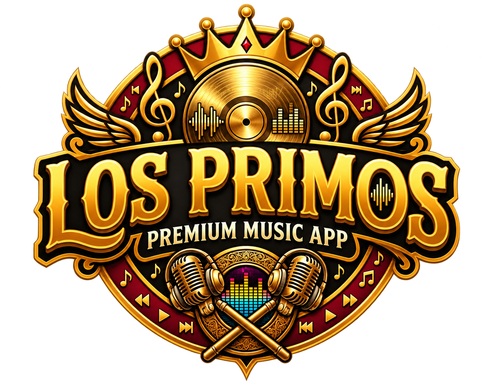

# Los Primos Music iOS

<p align="center">
  
</p>

> Cliente de música nativo para **iOS (iPhone e iPad)** com a identidade visual **Los Primos**, reprodução em segundo plano sem anúncios, letras sincronizadas em tempo real e integração com a tela de bloqueio do iOS.

---

## Recursos Principais

- **Reprodução em Segundo Plano (Background Audio):** Configuração nativa com `AVAudioSession` e `AVPlayer` — o áudio continua tocando com a tela apagada ou usando outros apps.
- **Tela de Bloqueio & Central de Controle:** Integração total com `MPNowPlayingInfoCenter` e `MPRemoteCommandCenter` (Play, Pause, Skip, Seek).
- **Sem Anúncios:** Conexão direta com a API InnerTube (usando o cliente nativo VisionOS que retorna streams diretos sem risco de quebra de deofuscação).
- **Letras Sincronizadas (Karaokê):** Integração com a API LRCLIB com rolagem automática conforme a música toca.
- **Design System Oficial Los Primos:**
  - Paleta: Ouro Real (`#F2B01E`), Vinho Nobre (`#B3152B`) e Fundo Escuro Intenso (`#0D0907`).
  - Tipografia: *Plus Jakarta Sans* e *Inter*.
  - Miniplayer flutuante persistente e Full Player expansível.

---

## Estrutura do Projeto

```text
Los Primos Music iOS/
├── App/
│   ├── LosPrimosMusicApp.swift        # Inicialização do App e estilos globais
│   └── Info.plist                     # Permissões de Background Audio e Fontes
├── Core/
│   ├── Network/
│   │   ├── InnerTubeClient.swift       # Busca e extração de stream do YouTube Music
│   │   └── LRCLIBClient.swift          # Letras sincronizadas
│   └── Player/
│       └── AudioPlayerService.swift    # Motor de reprodução AVPlayer + Lock Screen
├── Models/
│   └── Song.swift                      # Modelos de Dados (Song, Artist, Lyrics)
├── DesignSystem/
│   ├── BrandColors.swift               # Cores oficiais e gradientes Los Primos
│   ├── BrandTypography.swift           # Fontes e dimensões semânticas
│   └── BrandComponents.swift           # Botão Play/Pause Los Primos e linhas de música
├── Views/
│   ├── MainTabView.swift               # Barra de navegação inferior com Miniplayer
│   ├── Home/HomeView.swift             # Destaques, gêneros populares e recomendações
│   ├── Search/SearchView.swift         # Busca em tempo real de músicas e artistas
│   ├── Library/LibraryView.swift       # Fila de reprodução e dados do app
│   └── Player/
│       ├── MiniPlayerView.swift        # Miniplayer flutuante com barra de progresso
│       ├── FullPlayerView.swift        # Player em tela cheia com capa e controles
│       └── LyricsView.swift            # Letras sincronizadas rolantes
└── Docs/
    └── GUIA_INSTALACAO_IPHONE.md       # Passo a passo de instalação no iPhone
```

---

## Como Instalar no iPhone

Consulte o documento completo: [GUIA_INSTALACAO_IPHONE.md](file:///F:/Los%20Primos%20Music%20iOS/Docs/GUIA_INSTALACAO_IPHONE.md).
